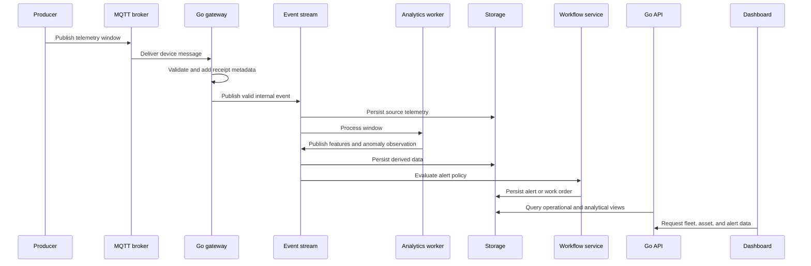

# Data Flow

- **Status:** Proposed
- **Version:** 0.1

This document owns the lifecycle of data after it enters the platform: stages, meaning changes, delivery behavior, failure paths, replay, and read-model handoff. The [telemetry contract](../specs/telemetry-contract.md) owns producer fields and validation; [runtime boundaries](runtime-boundaries.md) owns component responsibility.

## End-to-end flow



## Data stages

### 1. Produced

A simulator or edge device creates a telemetry window. At this stage, the data contains producer identity, event time, sequence information, sampling metadata, and measurements.

### 2. Received

The gateway adds platform-side receipt information. Receipt time must not overwrite event time because the two values answer different operational questions.

### 3. Validated

The gateway and downstream validators determine whether the envelope and measurements satisfy the active contract. Validation failures should contain machine-readable and human-readable reasons.

### 4. Quarantined

Messages that cannot safely enter normal processing are retained or routed to a quarantine/dead-letter path according to the failure class. The system should preserve the original payload when doing so is safe.

### 5. Persisted

Valid source telemetry is stored with its identity and contract version. Raw or source data should remain available long enough to support investigation and reprocessing.

### 6. Featured

Analytics workers normalize a window and calculate a versioned feature vector. Feature records refer to the source event and feature-definition version.

### 7. Predicted

A baseline rule or anomaly model produces an anomaly observation. The output includes the method, model version if applicable, score, any assigned analytical severity, and supporting features.

### 8. Operationalized

Alert policy determines whether the observation creates or updates an operational alert. A work order is created only through the maintenance workflow.

## Event identity and ordering

The producer assigns a stable `event_id` as defined by the
[telemetry contract](../specs/telemetry-contract.md) and a device-local
sequence number. The event ID identifies the window across retries; the
sequence supports ordering and gap detection. The gateway adds receipt
metadata but preserves producer identity and event time.

The initial processing model should assume:

- messages may be delivered more than once;
- messages may arrive out of order;
- a sequence may contain gaps;
- a device may reconnect after an interruption; and
- a consumer may restart after receiving a message but before completing its side effect.

These cases should be visible in logs and metrics rather than silently normalized away.

## Idempotency model

The first implementation should define an idempotency key before writing consumers. The likely starting point is the producer event identifier, with device identity and schema version available for validation.

Every side effect should answer:

- How is a duplicate detected?
- Is the duplicate ignored, merged, or recorded?
- Can the operation be safely retried after a partial failure?
- Does replay use the same identity or a derived replay identity?

The final policy belongs in a dedicated ADR after the replay and storage design is implemented.

## Failure paths

```text
invalid MQTT payload
    → validation error
    → quarantine or dead-letter path
    → metric and structured log

consumer processing error
    → retry policy
    → backoff
    → dead-letter path after retry limit
    → operator-visible metric

database unavailable
    → consumer does not acknowledge successfully
    → message remains eligible for retry
    → recovery is measured and documented

malformed derived event
    → derived-event validation failure
    → source event remains traceable
    → model or feature version is investigated
```

The exact retry and acknowledgement behavior must be tested rather than inferred from the diagram.

## Data retention and reproducibility

Retention periods are initially configuration values, not product promises. The project should document:

- what data is retained;
- which data can be regenerated;
- which data is considered an immutable source;
- how experiments identify their inputs; and
- how synthetic datasets are recreated.

## API read model

The dashboard should not need to understand the event stream. The API should expose product-oriented views such as:

- fleet health summary;
- asset detail and time range;
- feature and spectrum history;
- alert evidence;
- work-order state; and
- device connectivity.

Query optimization and pre-aggregation should be driven by measured behavior during the product and reliability phases.
