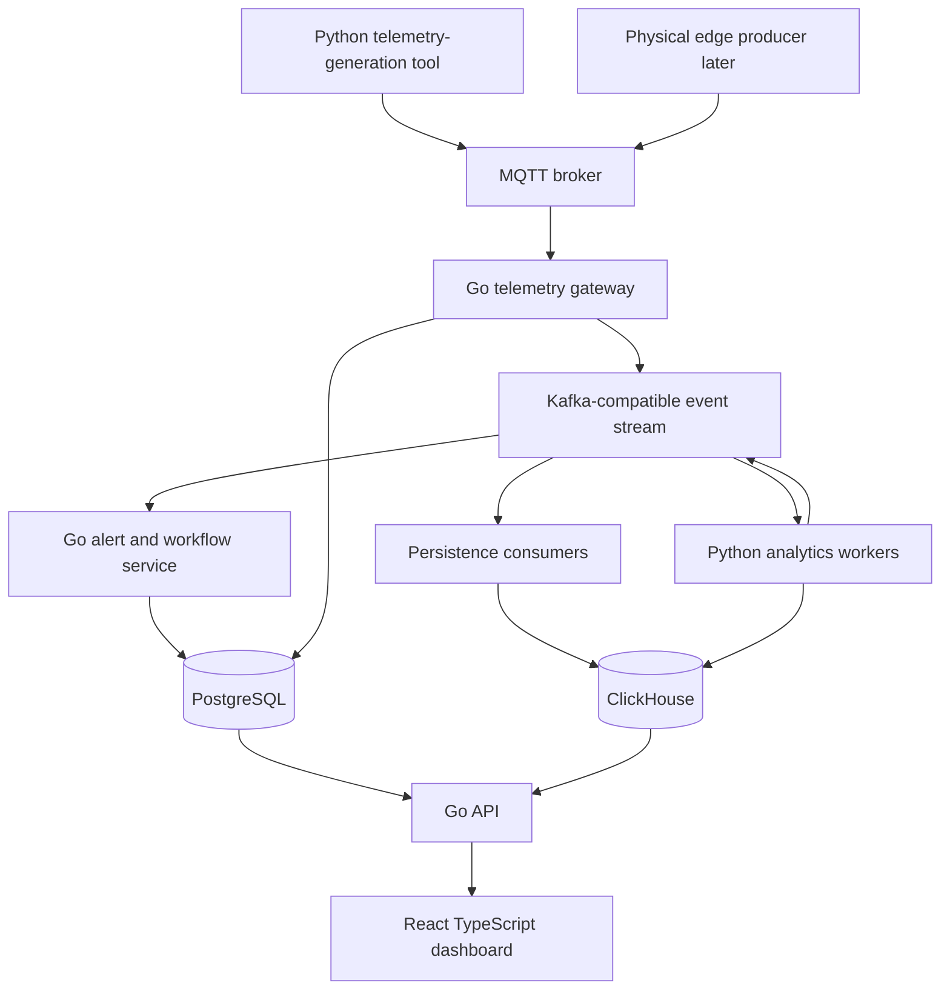

# Architecture Overview

- **Status:** Proposed
- **Version:** 0.1

This document owns the logical system shape, storage roles, initial deployment direction, and architectural evolution rules. [Runtime boundaries](runtime-boundaries.md) owns component responsibilities; [data flow](data-flow.md) owns event stages and failure behavior; specifications own external and capability contracts.

## Architectural intent

MachinePulse is a local-first, event-driven system that can accept simulated or physical telemetry. The first architecture should demonstrate clear responsibilities without creating unnecessary operational complexity.

The design prioritizes:

- a stable producer contract;
- traceability from user-facing actions back to source measurements;
- safe retries and replay;
- observable failure modes; and
- a path from a local environment to a more distributed deployment when evidence requires it.

## Logical architecture

This is a logical view. It does not imply that every box must initially be a separate deployable process.
The simulator is an engineering tool that produces synthetic telemetry, not a
user-facing application or an independently deployed service.

## Responsibility references

The [runtime-boundaries matrix](runtime-boundaries.md) is the source of truth for ownership, language direction, inputs, outputs, and cross-boundary rules. The [data-flow document](data-flow.md) describes how an event moves through those responsibilities and where its meaning changes, including the initial idempotency, replay, and failure questions.

## Storage roles

### PostgreSQL

Use PostgreSQL for relational, transactional state:

- assets and device associations;
- alerts;
- work orders;
- maintenance events;
- workflow state; and
- configuration that requires transactional updates.

### ClickHouse

Use ClickHouse for high-volume and analytical data:

- telemetry windows or normalized samples;
- derived features;
- anomaly observations and health history;
- benchmark or aggregate query data; and
- time-oriented investigation views.

The exact granularity and table design are implementation decisions for the data-platform phase.

## Initial deployment direction

The first environment should run locally with Docker Compose and use a small number of runtime units. A possible initial arrangement is:

- one Go API/gateway process;
- one or more Python analytics workers;
- one event-stream broker;
- one MQTT broker;
- PostgreSQL;
- ClickHouse; and
- optional observability services.

This grouping is provisional. Splitting or combining processes requires evidence of a responsibility, failure-isolation, or scaling need and should be recorded in an ADR when the decision is durable.

## Architectural evolution

External and internal contracts must be versioned. Contract ownership and the current registry are maintained by the [specifications index](../specs/README.md).

New runtime boundaries, storage strategies, serialization formats, or model-serving approaches should solve a demonstrated problem. Record significant choices, alternatives, and consequences in an [ADR](../adr/README.md); use an [experiment](../experiments/README.md) when measured behavior is needed before deciding.

Local development must not require committed credentials or proprietary data. Any non-local deployment claim requires explicit security, operations, and evidence documents.
