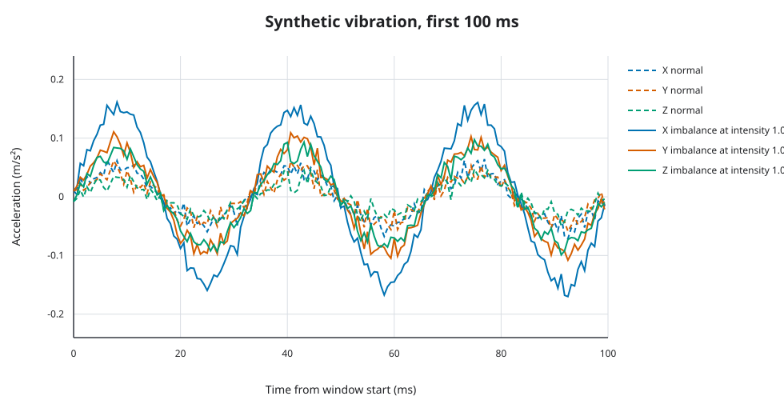
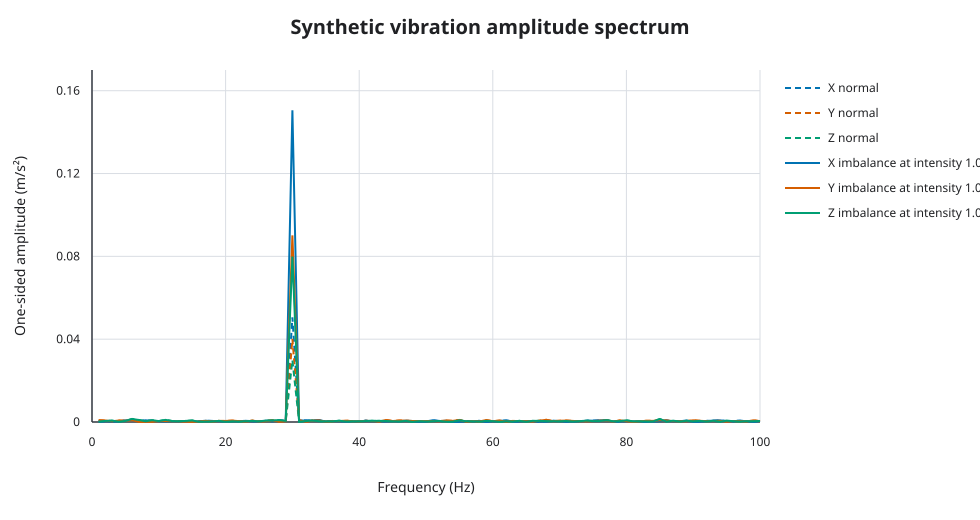
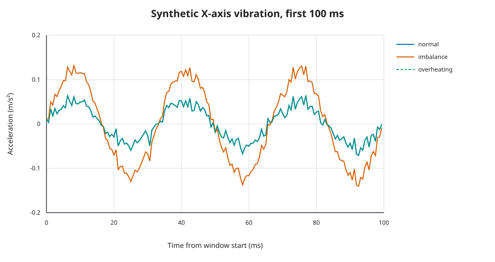
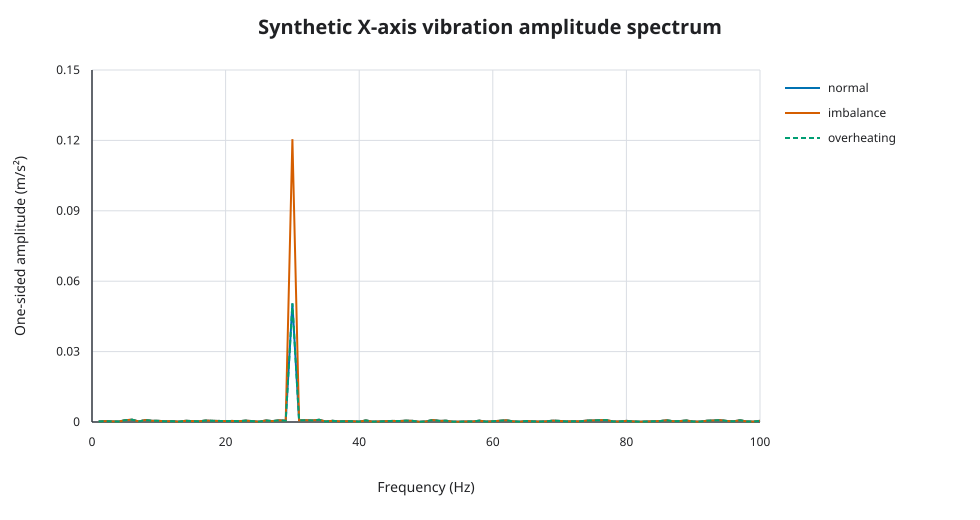
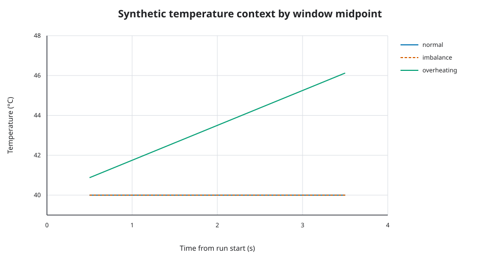

# From Machines to Data: Modeling Industrial Sensor Telemetry Without Hardware

- **Status:** Draft
- **Related journal:** [Week 01](../journal/week-01-simulated-world.md)
- **Specification:** [Simulator behavior](../specs/simulator.md)
- **Experiments:** [EXP-0001](../experiments/EXP-0001-simulator-parameters.md), [EXP-0002](../experiments/EXP-0002-condition-separation.md)

## What can we learn from sensor telemetry before connecting a sensor?

A condition-monitoring pipeline needs more than a stream of numbers. It needs
units, timestamps, sample rates, event identities, and a way to reproduce the
data behind a result. MachinePulse starts with a software simulator so that
these data boundaries can be exercised before physical hardware is introduced.

The simulator is deliberately a small engineering model: one rotating motor,
three vibration axes, temperature, RPM, and three controlled conditions. Its
signals are generated by explicit equations and parameters. They are useful for
testing software behavior, but they are not measurements of a real motor and
do not represent validated failure physics.

## Start with a producer contract

Each generated window follows the versioned [`telemetry.v1` contract](../specs/telemetry-contract.md).
The [telemetry generator and validator](../../tools/simulator/src/machinepulse_simulator/telemetry.py)
produce event and asset identifiers, a UTC event time, a device-local sequence,
sampling metadata, three arrays of acceleration samples, and scalar temperature
and RPM context. This keeps the simulator on the same interface planned for a
later physical producer.

A run also has a manifest containing its effective configuration, seed,
generator version, and source revision state. The condition label and its
intensity are recorded in a separate ground-truth sidecar keyed by event ID.
That separation means downstream code can consume the same telemetry shape a
device producer would send without accidentally treating the known scenario
label as a sensor measurement.

## Make generated runs repeatable

Repeatability depends on more than setting a random seed. The effective
configuration includes a fixed run start time, the run ID, sampling settings,
signal parameters, and the selected condition. The generator uses the seed for
noise and a deterministic UUIDv5 event identity for each device, run, and
sequence tuple. Re-running the same configuration with the same generator
version therefore reproduces event order, timestamps, telemetry values, and
sidecar records.

The [CLI regression test](../../tools/simulator/tests/test_cli.py) generates
normal, imbalance, and overheating runs twice. It compares the bytes of each
manifest, telemetry JSONL file, and ground-truth JSONL file, then checks event
ordering and the matching event IDs. It also verifies that condition labels
appear in the sidecar and not in telemetry.

## Explore what the controlled signals do

The first parameter experiment uses a one-second window sampled at 1600 Hz,
1800 RPM, and noise with a standard deviation of 0.01 m/s². At 1800 RPM the
simulated rotational component is 30 Hz. A one-second sample gives a 1 Hz DFT
grid, so the 30 Hz component lands directly on a frequency bin. A 250 ms window
has 4 Hz spacing and does not include a 30 Hz bin; a 500 ms window gives 2 Hz
spacing and does.





Across the tested 400, 800, and 1600 Hz sample rates, the one-second synthetic
signals retained a dominant 30 Hz peak. Increasing noise from 0.005 to
0.02 m/s² raised time-domain RMS and peak variation, while the measured
one-second 30 Hz amplitude stayed close to its configured value. These
measurements support keeping the current settings as readable, repeatable
engineering examples. They do not establish minimum sampling requirements or
acceptable noise levels for physical equipment.

EXP-0002 holds seed, RPM, sampling, and signal parameters constant while
comparing normal operation with imbalance and overheating at intensity 0.7.
The imbalance model adds a rotational component, raising the X-axis 30 Hz
amplitude from 0.050545 to 0.120543 m/s² in this run. Overheating changes the
temperature context but leaves vibration identical to the seeded normal
baseline. Its temperature values are sampled at window midpoints, rising from
40.875 °C in the first window to 46.125 °C in the last of four windows.







The plots show that the simulator creates distinct, controllable inputs for
downstream tests. They do not show that a real motor's imbalance or overheating
would produce these signatures. In particular, this version intentionally has
no overheating-specific vibration model, so vibration alone cannot distinguish
its overheating scenario from the normal baseline.

## Reproduce the evidence

From the repository root, use the pinned toolchain:

```sh
mise run simulator:experiment:vibration
mise run simulator:experiment:conditions
mise run simulator:check
```

The first command writes the EXP-0001 plots and parameter comparison; the
second writes the three EXP-0002 figures and its summary table. The documented
[simulator quickstart](../guides/simulator-quickstart.md) and
[multi-run configuration](../../tools/simulator/examples/runs.v1.json) generate
the example JSONL files and their manifest.

## What this evidence does not establish

The experiments use a small set of fixed configurations, controlled signals,
and deterministic noise. They do not include changing loads, transients,
mounting variation, calibrated sensor response, or real machine data. A visible
spectral peak in a generated signal is evidence that the software produces the
configured pattern, not evidence of a diagnosed fault. Health scores and
anomaly results built from these data will need separate evaluation and clear
limitations.

The next engineering step is to connect this stable telemetry contract to the
ingestion path. A physical producer can then be compared against the simulator
under a separately designed experiment without changing the meaning of
production telemetry.
