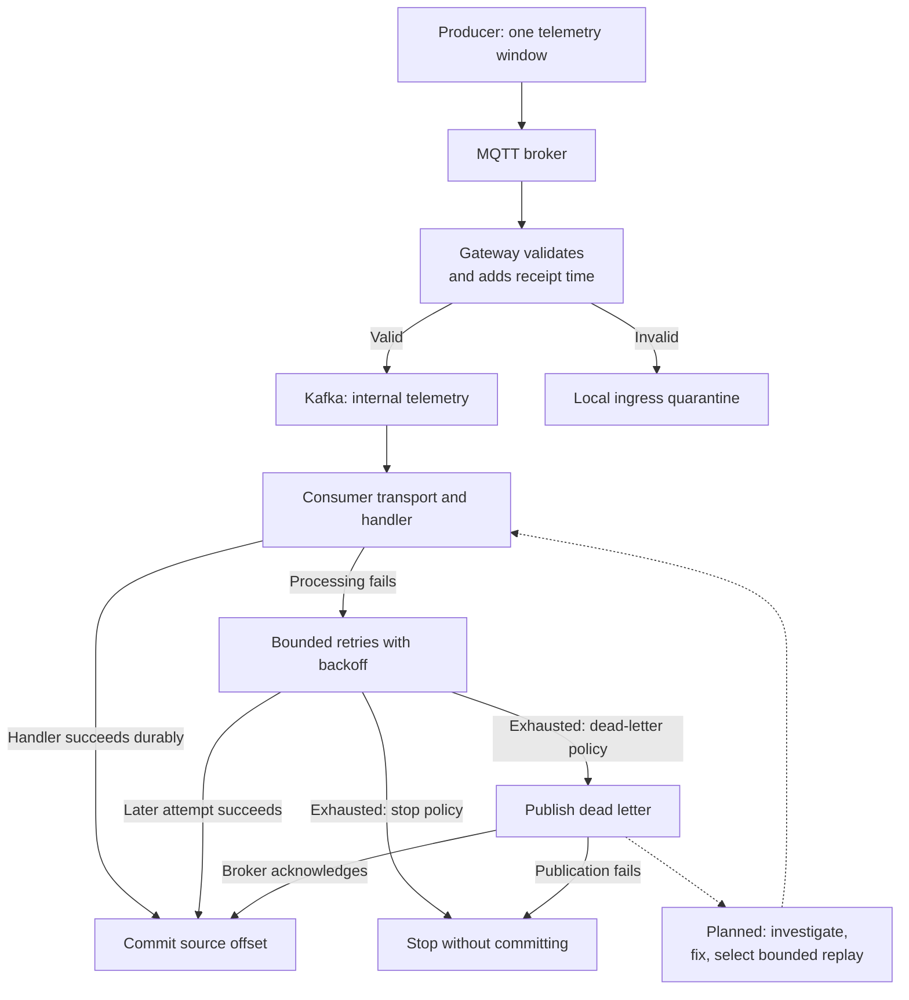

# From a machine measurement to a handled event

Imagine a motor producing one window of vibration samples, temperature, and
RPM. We want that window to reach storage, support analysis, and eventually
help someone decide whether maintenance is needed. A network interruption or
failed database write should leave enough evidence to recover the window and
understand what happened.

This guide follows that single window through MachinePulse. It explains how
the pieces fit together; the linked specifications own their exact contracts.
It is a walkthrough, with links to runnable component guides where commands
exist. The synthetic signals and later analytical results are engineering
evidence, not validated machinery diagnoses.

## Where the walkthrough meets the implementation

The simulator currently writes local datasets. The gateway can receive a
published fixture over MQTT, validate it, quarantine invalid input, and publish
valid events to Kafka. The consumer transport added under
[#24](https://github.com/gleniosp/machinepulse/issues/24) supplies retry,
commit, and dead-letter behavior as a Go API; it still needs a durable domain
handler and application wiring. These local changes await review and merge.

Storage, durable duplicate protection, controlled replay, analysis, and the
maintenance workflow are later capabilities. Their GitHub issues own delivery
status. References to those stages below describe the intended path, not a
running end-to-end application. In particular, there is no dead-letter replay
command today.



A commit after dead-letter publication means the failure has a durable
location for investigation. It does not mean the measurement reached its
business destination. The following sections explain that distinction.

## Give the window an identity before sending it

A **telemetry window** is one producer message containing a bounded set of
measurements. Its `event_id` identifies that window throughout its journey.
`device_id` identifies the producer and `asset_id` identifies the monitored
machine. A device sequence number helps detect ordering and gaps.

For our example, call the window **E**, from device **D** on motor **A**. These
letters are explanatory labels, not valid contract identifiers. If D retries
sending E, it must keep E's identity. A second measurement window gets its own
identity even if its measured values happen to match E.

`occurred_at` says when the window's first vibration sample was captured. A
window arriving late is still that historical window; the gateway does not
replace its event time with today's arrival time. The
[telemetry contract](../specs/telemetry-contract.md) owns identifiers, sequence,
measurement fields, units, and validation rules.

For local synthetic input, the [simulator quickstart](simulator-quickstart.md)
explains `telemetry.jsonl`, the generation manifest, and separate ground truth.
Ground truth describes the simulated condition for evaluation; it does not
become a diagnosis attached by the producer. The simulator currently stops at
file output. [#25](https://github.com/gleniosp/machinepulse/issues/25) owns proving
the simulator-to-stream integration path. Physical producers and restart-safe
edge buffering belong to the later physical-edge phase.

## Hand E to the MQTT broker

The device-facing route is:

```text
machinepulse/v1/telemetry/{device_id}
```

D sends E to its own route using MQTT 5 and QoS 1. **QoS 1** allows delivery
more than once. **PUBACK** is the protocol acknowledgement of a publication.
The producer receiving PUBACK knows the MQTT broker accepted the publication;
it cannot conclude that E passed validation, reached Kafka, or was stored in a
database.

The gateway subscribes to the device routes. Its persistent MQTT session lets
the broker retain eligible pending deliveries across disconnects, within the
configured session expiry and broker capacity. The gateway uses a stable client
ID to resume that session. Broker session persistence and a producer's own
outgoing buffer solve different interruption points; neither provides an
unlimited source archive.

Telemetry is published without the Retain flag. A retained MQTT message would
supply the last value to a new subscriber, which is unsuitable for replaying a
history of measurement windows. The
[ingestion specification](../specs/ingestion.md#protocol-and-delivery) owns
session, reconnect, acknowledgement, and retention semantics.

## Let the gateway decide whether E can enter the platform

The gateway checks the producer contract and transport metadata. For example,
the device in the MQTT route must match the payload device, RPM cannot be
negative, and the JSON must be valid under the gateway's parsing rules.
Deployment-specific measurement bounds can add checks. The gateway preserves
source values rather than clamping them to fit.

It also records `gateway_received_at`, a separate UTC timestamp for this
receipt attempt. E's `occurred_at` still identifies capture time. If the gateway
receives E again later, its receipt timestamp may differ while E's identity
and source time stay the same.

Two outcomes are possible after application validation:

| Outcome      | Durable destination before MQTT acknowledgement |
| ------------ | ----------------------------------------------- |
| E is valid   | The internal Kafka telemetry topic              |
| E is invalid | The configured local ingress quarantine         |

If the destination fails, the gateway leaves the MQTT delivery unacknowledged.
The current runtime requires reconnection or restart to redeliver a pending
failed disposition. Its one-message receive limit prevents later deliveries
from passing that pending delivery. The
[gateway guide](../../services/telemetry-gateway/README.md) explains how to run
this path, publish fixtures, and find its logs and configuration.

For malformed telemetry JSON or other invalid application payloads, the broker
has already acknowledged the producer's publication; that is a separate MQTT
exchange from the gateway's acknowledgement of its subscriber delivery. After
the gateway durably quarantines the rejected payload, it acknowledges that
delivery, so the broker can discard its queued copy. If quarantine storage
fails, the gateway withholds that acknowledgement. The current implementation
does not retry quarantine on the same connection: it leaves the delivery
pending and redelivers it after a gateway reconnect or restart if the MQTT
session is still present, while its
one-message receive limit applies backpressure. This is not an endless
same-connection retry loop. See the [ingestion delivery contract](../specs/ingestion.md#acknowledgements-and-failure-handling)
and [gateway quarantine behavior](../../services/telemetry-gateway/README.md#run-locally).

An oversized MQTT frame is a separate case: the gateway closes the connection
before application delivery and cannot write that frame to quarantine.

## Keep rejected input in ingress quarantine

Suppose E has negative RPM. Retrying a database write will not repair that
input. The gateway records the original bytes, recoverable identity, receipt
and transport metadata, a payload digest, and an actionable validation reason
in a local quarantine record. Identity recovered from invalid input remains
untrusted.

The file must reach the configured durable disposition before the gateway
acknowledges MQTT. A failed filesystem write leaves E pending. A crash after
writing the record but before acknowledgement can produce another quarantine
record for the same rejected input on redelivery.

This quarantine is a filesystem destination at ingress. A downstream
**dead-letter topic** is a Kafka destination after consumer processing fails.
They serve related investigation needs but have different storage locations,
record formats, and recovery boundaries. Inspect the
[quarantine contract](../specs/ingestion.md#local-ingress-validation-and-quarantine)
and the gateway's configured directory or container volume before investigating
an ingress rejection. There is no automatic quarantine replay or cleanup today.

## Wrap valid E for the internal stream

For valid E, the gateway constructs an **envelope**: the telemetry payload plus
platform metadata. The outer version is `internal.telemetry.v1`; the original
payload remains `telemetry.v1`. The envelope indexes E's source identity and
keeps the gateway receipt time separate from the source capture time.

The internal Kafka topic is `machinepulse.telemetry.v1`. Its name is independent
of the MQTT route. Its key is D's device identifier, grouping one device's
publications into the same Kafka partition. A **partition** is an ordered log;
arrival order in that log need not match the measurements' capture-time order.

Kafka acknowledges the synchronous publication before the gateway acknowledges
MQTT. A missing topic, timeout, or broker error leaves MQTT unacknowledged.
Topics must be provisioned explicitly. The
[internal telemetry specification](../specs/internal-telemetry.md) owns the
actual envelope and topic policy; the gateway guide supplies setup commands.

Our local Kafka environment has one broker. Its acknowledgement establishes
broker acceptance within the local persistence assumptions; it does not prove
replica availability or recovery from power loss.

## A consumer receives a record, then performs its work

A **consumer group** tracks progress for a logical consumer. Different groups
can process the same telemetry independently. Each record has a topic,
partition, and **offset**, its position in that partition. An offset identifies
a transport location; E's `event_id` remains the identity used across retries,
republication, and later processing.

The initial consumer loop fetches one record and processes it serially. It
checks the envelope version and source/payload consistency, then calls a
**handler**, the function responsible for the actual side effect. A future
storage handler might durably persist E before returning success.

Fetching does not commit progress. A **commit** records the group's completed
position. The loop commits only after handler success or acknowledged
publication to the dead-letter topic. It stops if that commit fails, so a later
successful record cannot advance the position past the unresolved record.

The current transport API has no domain persistence handler or standalone
consumer command. [#30](https://github.com/gleniosp/machinepulse/issues/30) owns
persisting validated telemetry. A handler must honor cancellation and timeouts
and return success only when its side effect is durable.

## Retry a failed attempt with a bounded budget

Suppose the future storage handler receives E while its database is unavailable.
The loop does not commit a failed attempt. Its policy specifies:

- `MaxAttempts`: total attempts for this delivery, including the first;
- `Backoff`: a fixed positive wait between failed attempts;
- `OperationTimeout`: a deadline for each attempt and disposition operation;
- `Terminal`: what happens after exhaustion, either `stop` or `dead-letter`.

For illustration, three attempts means one initial try and at most two retries.
If the database recovers on the second attempt, the handler persists E and the
loop commits the source offset. If all three fail, the terminal policy decides
the next action. These are explanatory values, not deployed defaults.

With `stop`, the loop returns an error without committing. An operator or process
supervisor must address the cause and restart consumption. With `dead-letter`,
the loop tries to retain the failure in Kafka before committing. Cancellation
also stops processing without committing. The attempt budget starts again on
broker redelivery; the attempt count is not a lifetime total for E.

## Understand why successful processing can happen twice

Imagine the database stores E successfully, then the process crashes before
committing its Kafka offset:

```text
Store E durably → crash → no confirmed commit
Restart group → receive E again → handler runs again
```

A similar gap exists between Kafka accepting E and the gateway acknowledging
MQTT. Delivery retries preserve data, but they can repeat work. A transport log
showing the same E twice exposes the repetition; it does not suppress a second
side effect.

**Idempotent persistence** makes repeated delivery safe: processing E again
must not create uncontrolled duplicate records. That durable protection belongs
to [#32](https://github.com/gleniosp/machinepulse/issues/32), including keys,
conflict behavior, and duplicate fixtures. It is not implemented by the current
transport loop. A cache of recently seen IDs would lose protection on restart
and would not by itself solve a crash between storing data and remembering the
ID. Storage design must define the durable consistency boundary.

Two deliveries with the same ID but different content also need an explicit
conflict policy; silently treating the second as an ordinary duplicate could
hide corruption. Reprocessing with a new calculation version must preserve
source identity while making the new derived result distinguishable.

## Move exhausted failures to the dead-letter topic

Under dead-letter policy, the loop writes to
`machinepulse.telemetry.dead-letter.v1`. The record retains the original Kafka
key and bytes, topic/partition/offset, consumer group, attempts, final failure
reason, and UTC failure time. Byte fields are base64 in its JSON envelope, so
arbitrary original bytes remain recoverable. The exact format belongs to the
[consumer contract](../specs/internal-telemetry.md#consumer-disposition-p02-006-proposal).

The original bytes contain E's identity when the envelope is valid. A malformed
envelope can still be investigated using its raw bytes and transport coordinates.
The loop does not pass inconsistent provenance to the domain handler.

Only after Kafka acknowledges the dead-letter publication does the loop commit
the original offset. If publication fails—for example, because the topic is
missing or the record is too large—the loop stops without committing. If the
publication succeeds but the commit fails, restarting may produce another dead
letter for E. Recovery must allow for duplicate failure records too.

Provision the dead-letter topic explicitly and inspect its actual retention and
capacity. Its specified local policy follows the source topic's seven-day
retention. Retention is finite; it is not an investigation acknowledgement or a
promise to retain a failure until someone resolves it.

## Investigate, repair, and verify recovery

The following is the intended operator workflow. Inspection can use existing
Kafka clients; selection, replay, and recovery accounting still need the tooling
tracked in [#33](https://github.com/gleniosp/machinepulse/issues/33).

1. **Preserve the evidence.** Locate the dead letter and retain the original
   bytes and failure metadata before topic retention removes them. Use the group
   and source coordinates to relate it to the consumer logs. Multiple letters
   may represent the same source event.
2. **Classify the failure.** Determine whether the dependency is unavailable,
   the handler has a bug, or the input cannot satisfy its contract. For invalid
   input, inspect the bytes rather than trusting recovered metadata.
3. **Correct the cause.** Restore the dependency or deliver and validate the
   processing fix. Invalid input may need a documented correction or a decision
   to retain it for investigation. Do not overwrite the original evidence.
4. **Select a bounded recovery set.** Identify the failed consumer and the
   events to retry, constrain the count or time range, and check that its side
   effects are idempotent. A reset of the whole group's offsets can repeat
   unrelated successful work; recovery needs explicit selection.
5. **Replay with provenance.** Preserve original event identity and history,
   distinguish replay from live processing, and record the processing version.
   The replay design must specify the destination and how it resumes the failed
   stage. No replay destination or command is implemented yet.
6. **Verify the result.** Confirm the intended durable data or side effect,
   correlate replay outcomes to the selected failures, and account for records
   that fail again. Starting a replay or seeing a commit alone does not prove
   business recovery.

Recovery must not depend on deleting failure evidence. Repeating or interrupting
replay must remain safe, and unresolved records need a visible outcome. The
replay issue owns the exact acceptance criteria and evidence requirements.
Ingress quarantine will need its own compatible lifecycle; a dead-letter replay
must not assume a filesystem quarantine record is an internal Kafka envelope.

## Follow E beyond storage

The intended later path uses stored source telemetry for versioned features,
anomaly observations, and health evidence. Alert policy then determines whether
an observation creates or updates an alert; the maintenance workflow owns work
orders. The API and dashboard expose product views over that state.

These are separate success boundaries. Kafka acceptance does not imply source
persistence; source persistence does not imply feature calculation; an anomaly
observation does not itself create a work order. Derived records must preserve
their link to E and identify calculation or model versions so investigation and
reprocessing can explain which result came from which input.

The [architecture data flow](../architecture/data-flow.md) owns the lifecycle,
[runtime boundaries](../architecture/runtime-boundaries.md) owns component
responsibilities, and [GitHub milestones](https://github.com/gleniosp/machinepulse/milestones)
own implementation scope and progress.

## Find evidence at the boundary you are investigating

| Question                                    | Evidence to inspect                                                    |
| ------------------------------------------- | ---------------------------------------------------------------------- |
| What did the synthetic producer generate?   | Telemetry JSONL, generation manifest, separate ground truth            |
| Did the MQTT broker accept the publication? | Producer MQTT acknowledgement                                          |
| Did validation reject it?                   | Gateway rejection reason and local quarantine record                   |
| Did the gateway complete its disposition?   | Gateway disposition logs and the actual Kafka or quarantine record     |
| Which consumer attempt failed?              | Group, event/device ID, topic/partition/offset, attempt and error logs |
| Was failure disposition completed?          | Dead-letter record and consumer disposition log                        |
| Did the intended business work finish?      | The handler's durable destination and later recovery evidence          |

The [Week 02 journal](../journal/week-02-telemetry-ingestion.md) records tests and
limits already observed. `mise run gateway:test` exercises injected consumer
failures; `mise run gateway:test:integration` exercises real broker redelivery
and dead-letter publication. These tests establish the transport behavior, not
completion of the later storage and maintenance path.
