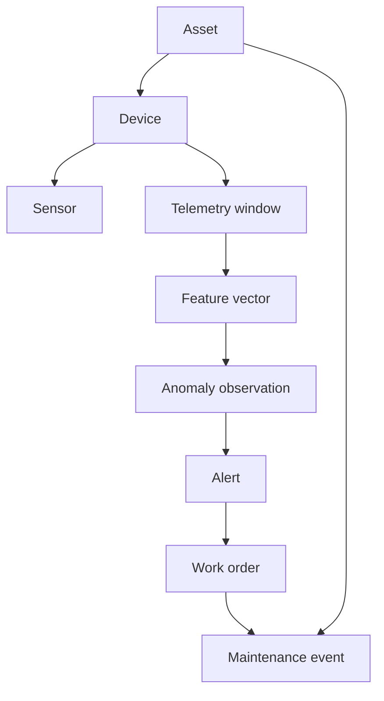

# Domain Model

- **Status:** Draft
- **Version:** 0.1

This document owns the canonical domain entities, their relationships, and the traceability rules between them. Shared technical vocabulary such as event time, replay, and idempotency is maintained in the [glossary](glossary.md); transport and field-level semantics belong to the relevant [specifications](../specs/README.md).

## Core entities

### Asset

A maintainable physical object, initially an electric motor.

Important attributes include:

- stable asset identifier;
- display name;
- asset type;
- nominal RPM;
- location or grouping metadata; and
- current operational status.

### Device

A telemetry-producing device associated with an asset. A device may be the Python simulator during early development or a physical edge device later.

A device has:

- stable device identifier;
- producer type;
- contract version;
- connection status; and
- last-seen information.

### Sensor

A logical measurement source attached to a device or asset. Version 0.1 uses three logical sensor groups:

- vibration X/Y/Z;
- temperature; and
- RPM.

The model does not require every logical sensor to be a separate physical component.

### Telemetry window

A bounded record for a finite time interval. Its vibration axes are sampled on
a shared timeline; temperature and RPM are scalar context values associated
with that interval. Those context sensors may use different, slower update
rates, so the window does not imply that every measurement type has a
same-rate sample array. A window contains:

- device and asset identity;
- event and sequence metadata;
- sample rate and sample count;
- vibration arrays; and
- scalar temperature and RPM context.

The window keeps the vibration samples from one interval together as one
identified, timestamped event. This gives signal processing a bounded segment
for time-domain and frequency-domain calculations; an isolated vibration
sample does not contain the history needed to calculate those features. The
sampling metadata defines how the vibration arrays map to the interval, while
temperature and RPM provide scalar context for it. The window is therefore
the principal unit of transport, storage, replay, and signal processing in
version 0.1.

### Feature vector

Derived measurements calculated from a telemetry window. Examples include RMS, peak-to-peak amplitude, kurtosis, dominant frequency, and frequency-band energy.

Features must retain enough metadata to identify:

- the source telemetry window;
- the feature-definition version;
- the calculation time; and
- the operating context used by the calculation.

### Anomaly observation

A result indicating that a telemetry window or sequence of windows differs from an expected baseline.

An anomaly observation should include:

- score and, when assigned by downstream analysis or policy, analytical
  severity;
- detection method and model version;
- contributing features or rules; and
- source window references.

Analytical severity is derived downstream from telemetry, features, and the
documented detection or alert policy. It is not a raw measurement or a
simulator-controlled condition value.

### Alert

A user-facing operational object created from one or more anomaly observations. An alert adds workflow state, acknowledgement, notes, and lifecycle timestamps.

An alert is not the same thing as a model prediction. It is a product decision that may combine model output, thresholds, persistence, and operator policy.

### Work order

A requested maintenance action associated with an asset and optionally linked to an alert.

Version 0.1 needs only a minimal lifecycle, such as open, acknowledged, in-progress, completed, and cancelled.

### Maintenance event

A record of work or inspection performed on an asset. It can later provide context for analysis, but version 0.1 does not attempt to learn automatically from maintenance history.

### Simulator condition

Ground truth is the reference description of the scenario the simulator was
configured to generate. Because the simulator creates the data, it knows by
construction whether a window belongs to `normal`, `imbalance`, or
`overheating`. This label lets experiments compare downstream features or
model outputs with the generated scenario. It is not a sensor reading, a
prediction, or proof that a real machine has that physical condition.

A non-normal simulated condition may also have a `condition_intensity`
parameter describing how strongly the simulator applied that synthetic
effect. The condition and intensity are stored as experimental reference data
outside production telemetry; inference uses the telemetry and its derived
features, not these labels. Intensity is simulator input/reference metadata,
not analytical severity. See the [simulator behavior specification](../specs/simulator.md#ground-truth-sidecar)
for how the reference data is associated with each window.

## Relationships



## Identity and traceability

Every derived object should be traceable back to its source:

```text
work order
    → alert
    → anomaly observation
    → feature vector
    → telemetry window
    → device and asset
```

The trace should remain possible after retries, reprocessing, or model-version changes.

### Entity identity lifecycle

The accepted [ADR-0003](../adr/0003-device-and-asset-identifiers.md) defines
the telemetry contract's [device and asset ID profile](../specs/telemetry-contract.md#device-and-asset-id-profile)
and the domain identity rules:

- An asset ID identifies the maintainable object, not its name, location, or
  position in a production line. Renaming, relocation, and repair retain it;
  replacing that object creates a new asset ID, even when the name is reused.
- A device ID identifies a physical producer unit or a configured logical
  simulator producer. Restart, software update, credential rotation, and
  reassignment retain it. A replacement producer receives a new device ID.
  Restoring the same device's configuration retains its ID; cloning it into
  a distinct producer must allocate a new identity.
- Record device-to-asset assignment separately. Moving a device to another
  asset changes its association, not either entity's identity. Historical
  telemetry and its derived records retain the identities recorded at
  production time.
- Entity creation/provisioning assigns and persists IDs before telemetry is
  emitted. Retired IDs are not reassigned to new entities. Unknown references
  or conflicting registrations must be handled explicitly rather than merged
  because names match.
- Display labels, vendor serial numbers, and external-system identifiers are
  separate references with their own scheme/issuer scope. Preserve a trusted
  manufacturer product-instance URI or global asset identifier when available;
  a scoped serial number alone need not be globally unique. Customer asset
  numbers and physical tags also remain separate from the canonical entity ID.
- Customer ownership, site/location hierarchy, and asset relationships are
  modeled as explicit data, not encoded into entity IDs. If multi-tenancy is
  introduced, enforce tenant scope on lookup and write paths; possessing a
  syntactically valid or unpredictable ID does not grant access.
- MachinePulse IDs identify entity records. Independently enrolling the same
  physical motor in two installations does not automatically produce the same
  ID. Reconciliation uses trusted external identities or a reviewed mapping;
  importing an existing MachinePulse record preserves its key, while an
  identity conflict is resolved explicitly. Do not silently merge records or
  replace an established key with a newly discovered external identifier.

Enrollment and association storage/API mechanics belong to the later
ingestion and operational-storage specifications; these rules do not add an
online registry requirement to local simulator runs.

## Domain boundaries

- A **device** produces observations; it does not own maintenance policy.
- A **telemetry window** is raw evidence; it is not an anomaly by itself.
- A **feature vector** is derived data and must identify its calculation version.
- An **anomaly observation** is an analytical result; it does not automatically require physical intervention.
- An **alert** is an operational workflow object.
- A **work order** represents human action, not model certainty.

## Future extensions

The model may later add sites, production lines, components, sensor calibration, user roles, maintenance plans, and multiple asset types. These are intentionally not required for version 0.1.
