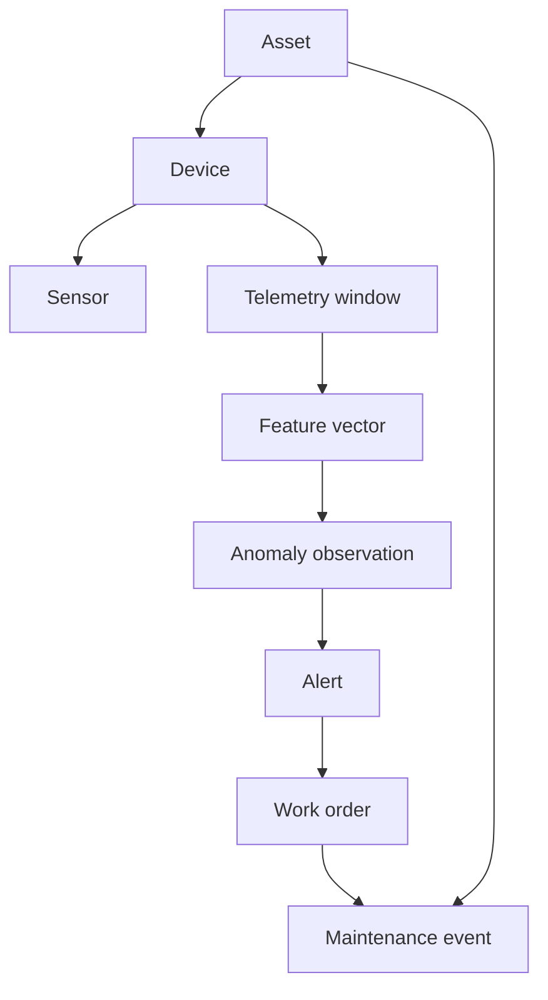

# Domain Model

- **Status:** Draft
- **Version:** 0.1

This document owns the canonical domain entities, their relationships, and the traceability rules between them. Shared technical vocabulary such as event time, replay, and idempotency is maintained in the [glossary](glossary.md); transport and field-level semantics belong to the relevant [specifications](../specs/README.md).

## Core entities

### Asset

A maintainable physical object, initially an electric motor.

Important attributes include:

- stable asset identifier;
- display name;
- asset type;
- nominal RPM;
- location or grouping metadata; and
- current operational status.

### Device

A telemetry-producing device associated with an asset. A device may be the Python simulator during early development or a physical edge device later.

A device has:

- stable device identifier;
- producer type;
- contract version;
- connection status; and
- last-seen information.

### Sensor

A logical measurement source attached to a device or asset. Version 0.1 uses three logical sensor groups:

- vibration X/Y/Z;
- temperature; and
- RPM.

The model does not require every logical sensor to be a separate physical component.

### Telemetry window

A synchronized group of raw samples observed over a finite time interval. A window contains:

- device and asset identity;
- event and sequence metadata;
- sample rate and sample count;
- vibration arrays; and
- scalar temperature and RPM context.

The window is the principal unit of transport and signal processing in version 0.1.

### Feature vector

Derived measurements calculated from a telemetry window. Examples include RMS, peak-to-peak amplitude, kurtosis, dominant frequency, and frequency-band energy.

Features must retain enough metadata to identify:

- the source telemetry window;
- the feature-definition version;
- the calculation time; and
- the operating context used by the calculation.

### Anomaly observation

A result indicating that a telemetry window or sequence of windows differs from an expected baseline.

An anomaly observation should include:

- score and severity;
- detection method and model version;
- contributing features or rules; and
- source window references.

### Alert

A user-facing operational object created from one or more anomaly observations. An alert adds workflow state, acknowledgement, notes, and lifecycle timestamps.

An alert is not the same thing as a model prediction. It is a product decision that may combine model output, thresholds, persistence, and operator policy.

### Work order

A requested maintenance action associated with an asset and optionally linked to an alert.

Version 0.1 needs only a minimal lifecycle, such as open, acknowledged, in-progress, completed, and cancelled.

### Maintenance event

A record of work or inspection performed on an asset. It can later provide context for analysis, but version 0.1 does not attempt to learn automatically from maintenance history.

### Simulator condition

Ground-truth context known by the simulator, such as `normal`, `imbalance`, or `overheating`. This is experimental metadata and must not be treated as a production sensor measurement.

## Relationships



## Identity and traceability

Every derived object should be traceable back to its source:

```text
work order
    → alert
    → anomaly observation
    → feature vector
    → telemetry window
    → device and asset
```

The trace should remain possible after retries, reprocessing, or model-version changes.

## Domain boundaries

- A **device** produces observations; it does not own maintenance policy.
- A **telemetry window** is raw evidence; it is not an anomaly by itself.
- A **feature vector** is derived data and must identify its calculation version.
- An **anomaly observation** is an analytical result; it does not automatically require physical intervention.
- An **alert** is an operational workflow object.
- A **work order** represents human action, not model certainty.

## Future extensions

The model may later add sites, production lines, components, sensor calibration, user roles, maintenance plans, and multiple asset types. These are intentionally not required for version 0.1.
