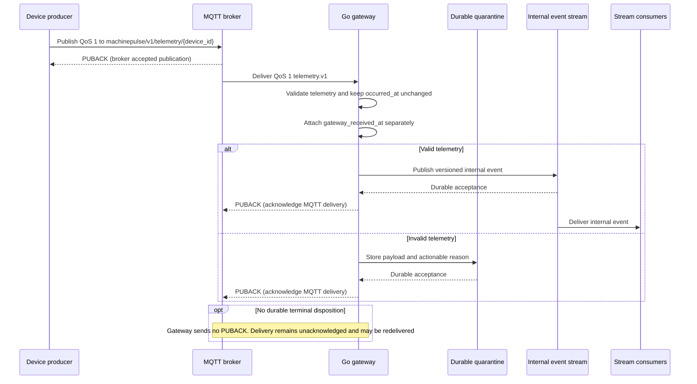

# Ingestion and Internal Event Boundaries

- **Status:** Accepted
- **Version:** 0.1
- **Related requirements:** FR-006–FR-010, NFR-003–NFR-006, NFR-011
- **Related specifications:** [Telemetry contract](telemetry-contract.md)
- **Related ADR:** [ADR-0004 — MQTT delivery semantics](../adr/0004-mqtt-delivery-semantics.md) (Accepted)
- **Related task:** [P02-001 — Specify MQTT topics and ingestion semantics](https://github.com/gleniosp/machinepulse/issues/19)

This specification defines the producer-facing MQTT topic convention and the
delivery boundary between MQTT and the internal event stream. It does not
define the internal event envelope or stream topic names; P02-005 owns those.
The maintainer accepted these semantics on 2026-10-15. Runtime behavior and
broker/client compatibility remain to be verified by the follow-up tasks.

## Boundaries and terms

| Boundary                           | Purpose                                         | Name space                                           |
| ---------------------------------- | ----------------------------------------------- | ---------------------------------------------------- |
| Producer → MQTT broker             | Accept device-published telemetry               | MQTT topic name                                      |
| MQTT broker → Go gateway           | Deliver device messages to the ingress consumer | MQTT subscription filter                             |
| Go gateway → internal event stream | Publish validated events for platform consumers | Stream-specific topic or subject, defined by P02-005 |

An MQTT topic name is not an internal event-stream topic. The gateway validates
the incoming `telemetry.v1` payload, adds gateway receipt metadata as defined
below, and publishes through the internal stream contract. It must not forward
an MQTT topic string as the internal topic name. The broker and event stream
may use different routing, retention, and acknowledgement policies.

## Device-facing MQTT topic

Use this case-sensitive MQTT topic name for one telemetry window:

```text
machinepulse/v1/telemetry/{device_id}
```

`device_id` is the canonical uppercase ULID in the payload, as specified by
the [telemetry contract](telemetry-contract.md#device-and-asset-id-profile).
The producer publishes to its exact topic; it does not use `+` or `#` wildcard
characters. The initial gateway subscribes to:

```text
machinepulse/v1/telemetry/+
```

The `v1` path segment versions this topic layout. It does not replace the
payload's `schema_version` (`telemetry.v1`); topic routing and payload schema
versions evolve independently. The initial system has no tenant, asset,
condition, or simulator segment in the topic. Asset association and synthetic
ground truth remain payload/sidecar concerns owned by their respective
contracts.

## Protocol and delivery

The initial protocol is MQTT 5.0. Its explicit session-expiry and
acknowledgement reason-code properties make reconnect behavior clearer for
this first implementation. Confirm that the broker and selected Go client
support the required behavior before implementation. MQTT 3.1.1 remains an
alternative if the chosen runtime cannot satisfy the behavior below; changing
versions requires revisiting session and error semantics.

Use QoS 1 from producer to broker and for gateway subscriptions. QoS 1 is
at-least-once delivery: duplicate application messages are possible, so the
gateway and downstream consumers preserve and use the producer's stable
`event_id`. Do not claim exactly-once processing or use QoS 2 for the initial
path. The protocol's Packet Identifier is transport state and is not a
replacement for the telemetry `event_id`.

Set the MQTT Retain flag to false for telemetry windows. A retained window
would be delivered as if it were current to a later subscriber. Offline gateway
delivery should use its persistent MQTT session; retained messages are not a
replay or source-data store.

### Sessions and reconnects

The gateway uses a stable client ID for the deployment, starts with
`Clean Start = 0`, and requests a configurable session expiry. The initial
expiry is 24 hours. On reconnect it checks the CONNACK Session Present flag:
use the existing subscription when the session exists, and subscribe to
`machinepulse/v1/telemetry/+` when it does not. The local broker must persist
session state for this behavior to survive broker restart; P02-002 owns that
environment configuration and its evidence.

Each producer uses a stable client ID tied to its device identity, starts with
`Clean Start = 0`, and requests the same configurable session expiry (initial
value: 24 hours). It resumes its QoS 1 client state on reconnect. A
reconnect uses exponential backoff with jitter and a configurable cap
(initial cap: 60 seconds). An application-level producer buffer is
still required when the process or device restarts; broker-side session state
is not a substitute for the edge buffer specified by P08-004. Producers retry
unacknowledged publications with the same `event_id` and preserve the client
protocol state needed to resume them.

The gateway's session expiry bounds how long the broker is asked to retain
queued delivery state. It is not a telemetry-retention guarantee. Expired,
over-capacity, or broker-lost messages require the producer's replay/buffer
path. Do not configure MQTT Message Expiry for source telemetry in the initial
system; historical windows remain useful to storage and replay even when
they arrive late.

### Acknowledgements and failure handling

The producer's MQTT PUBACK means that the MQTT server accepted ownership of
that QoS 1 publication. It does not mean that the gateway validated the payload
or that the internal stream stored it.

The gateway acknowledges a received QoS 1 message only after it has reached a
durable terminal disposition:

- a valid event has been accepted by the internal event stream; or
- an invalid event and its actionable reason have been durably recorded by the
  quarantine path.

If neither disposition is durable, the gateway must not acknowledge success;
it applies bounded backpressure/retry and exposes the failure. P02-003 must
select a client library that supports deferred acknowledgement or document an
equivalent mechanism that preserves this ordering. P02-004 owns invalid-message
validation and quarantine; P02-006 owns downstream consumer retry and
dead-letter behavior. A crash after durable publication but before MQTT
acknowledgement can cause redelivery, so `event_id`-based idempotency remains
required.

## Event time and gateway receipt time

The producer's `occurred_at` keeps its existing telemetry-contract meaning:
UTC time of the first vibration sample. The gateway must preserve it exactly;
broker or gateway time must not overwrite producer event time.

The gateway records a separate UTC `gateway_received_at` when it handles the
message attempt that is accepted into the internal stream. This timestamp
comes from the gateway host's wall clock. It can differ on a later redelivery
after a process or broker restart; it must not be represented as the event's
capture time or as a globally precise broker-arrival time. Internal event
envelope field names and fixture shape are owned by P02-005.

Use synchronized host clocks where available. Use a monotonic clock for
elapsed durations such as backoff and processing latency, not for event or
receipt timestamps. Ingestion may report suspicious clock skew, but it must
not silently rewrite `occurred_at`; any reject/quarantine threshold is a
deployment policy to be defined with P02-004.

## Internal event boundary

The gateway is the boundary crossing from external producer payload to
internal event. It validates the supported external contract before
publishing. The internal event is independently versioned and carries source
identity and contract-version provenance. P02-005 defines its exact name,
envelope, and fixtures. P02-001 establishes that:

- the device-facing route is the MQTT topic defined above;
- internal event routing belongs to the event-stream system;
- internal topic names and schemas are not MQTT topic aliases; and
- source `event_id`, `device_id`, `asset_id`, `occurred_at`, and
  `schema_version` remain traceable across the boundary.



The two PUBACKs have different meanings: the first confirms broker receipt to
the producer; the second is the gateway's acknowledgement to the broker after
a durable terminal disposition. The internal stream route is separate from the
MQTT topic. A later redelivery may repeat work, so consumers use the source
`event_id` for idempotency.

## Local ingress validation and quarantine

**P02-004 implementation proposal for maintainer review.** The accepted MQTT
acknowledgement ordering above remains the governing contract.

The gateway checks the stateless [telemetry validation rules](telemetry-contract.md#validation-rules)
before calling the valid-event handler. It also requires the MQTT topic device
ID to match the payload, QoS 1, and a false Retain flag. Invalid UTF-8, duplicate
JSON object keys, trailing JSON values, and nesting beyond 64 containers are
rejected with a field path, stable reason code, and actionable message. Integer
fields use JSON integer notation. UTC timestamps use the ISO date-time form
with seconds and an explicit zero offset or `Z`; source bytes are preserved.
The configured MQTT packet limit bounds receipt size; packets rejected by the
MQTT client before delivery cannot be quarantined by the application.

Temperature minimum/maximum and maximum absolute acceleration are optional,
inclusive deployment settings. Unset bounds impose no physical range policy;
finite-number and non-negative RPM checks always apply. The gateway does not
clamp measurements, reject clock skew, consult enrollment state, or deduplicate
events. Duplicate identity is preserved for the persistence/consumer owners.

The initial invalid path is a configured local filesystem directory on durable
storage. Each rejected delivery becomes a separate `quarantine.v1` JSON record
containing its exact payload as base64, SHA-256 digest, MQTT topic/QoS/Retain,
UTC receipt time, best-effort source string fields, and the validation reason.
Metadata from an invalid payload is untrusted. A new file is written and synced,
published atomically through a hard link to a unique `.json` filename, and its
directory synced before success. Existing records cannot be overwritten.
Write, sync, publication, cancellation, or acknowledgement failures are visible;
without confirmed durable disposition the delivery stays unacknowledged.
Temporary files left by a crash are not completed quarantine records. Retried
invalid deliveries may produce multiple records and retain the same digest.

Local process counters distinguish received, valid, invalid, quarantined, and
quarantine-failed deliveries and are emitted as structured log snapshots.
Validation success means the event reached the valid handler, not that the
internal stream accepted it. P02-005 supplies that durable handler; until then
valid deliveries remain pending. QoS 0 invalid deliveries can be recorded but
cannot obtain the QoS 1 acknowledgement or redelivery guarantees.

The host filesystem and persistent container volume own quarantine durability;
operators must provision capacity and retain the directory. There is no
automatic eviction, replay UI, or power-loss durability claim. Storage/replay
work owns later lifecycle integration.

## Acceptance evidence and limits

P02-001 is complete. The accepted topic naming, QoS, reconnect/session
behavior, retained-message policy, acknowledgement meaning, clock semantics,
and separation from internal event routing are defined here. Runtime behavior,
broker durability under failure, the selected Go client's manual-ack support,
and end-to-end delivery are tracked in the
[Phase 02 issues](https://github.com/gleniosp/machinepulse/milestone/3)
and [Week 02 evidence](../journal/week-02-telemetry-ingestion.md).

## Protocol reference

- [OASIS MQTT Version 5.0 specification](https://docs.oasis-open.org/mqtt/mqtt/v5.0/os/mqtt-v5.0-os.html) — QoS delivery flows, sessions, session expiry, retained messages, and acknowledgement reason codes.
